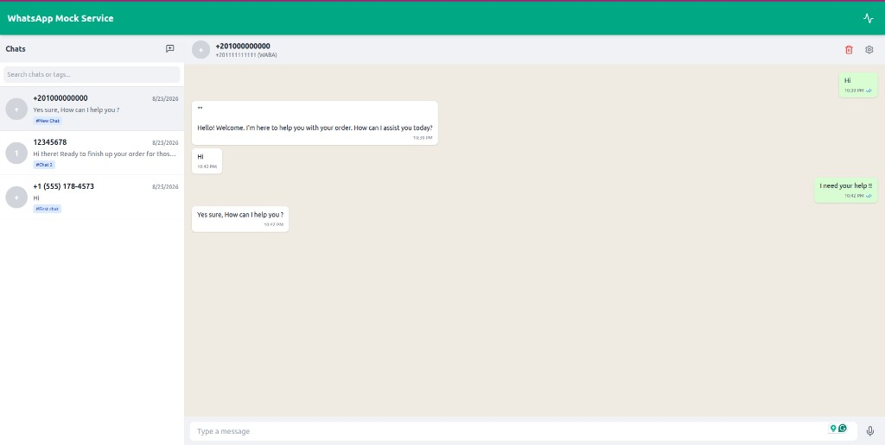
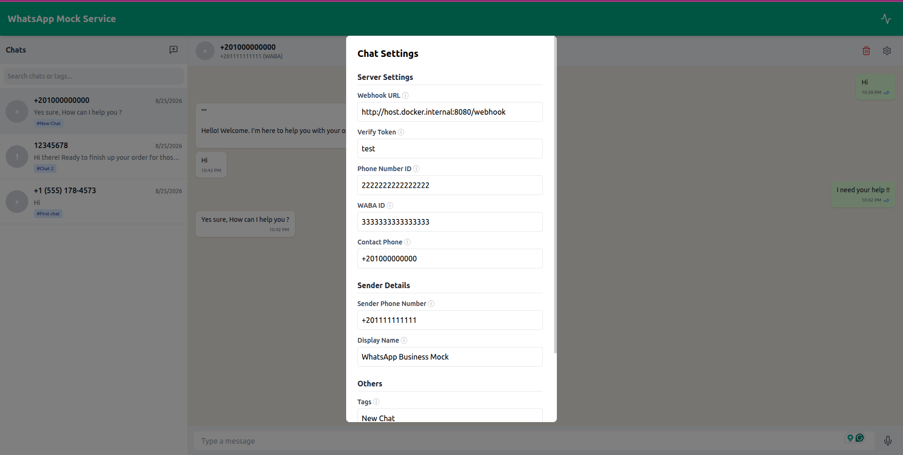
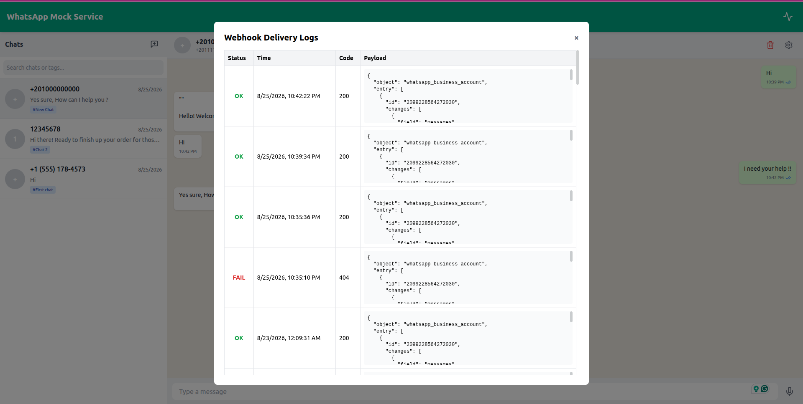

# WhatsApp Mock Service

A lightweight, self-hosted mock of the WhatsApp Cloud API — built for development and testing teams who want to simulate WhatsApp messaging **without** setting up a real Meta Business account or WhatsApp number.

> **For testing and development use only.** This project is not intended for production traffic.
---

## Why This Exists

Inspired by [MailHog](https://github.com/mailhog/mailhog)

Integrating with WhatsApp Cloud API requires a verified Meta Business Account, a dedicated phone number, and an approved application. This overhead slows down early-stage development and makes local testing cumbersome.

Beyond mocking the basic send/receive flow, the service is designed to make local WhatsApp integration testing as close to the real development experience as possible. It removes the need for public webhook URLs, port forwarding, or tunneling services by allowing each chat to define its own webhook endpoint, making it easy to work with multiple backend integrations simultaneously and route each conversation to the appropriate application. Developers can simulate incoming and outgoing messages entirely within their local environment, inspect conversations through the built-in chat UI, and test webhook-driven workflows without depending on external WhatsApp infrastructure. The service also supports voice notes, allowing audio-based messaging scenarios to be tested alongside regular text messages.

WhatsApp Mock Service eliminates that friction by:

- Mimicking the WhatsApp Cloud API endpoint contract (`/v22.0/<phone_number_id>/messages`)
- Forwarding inbound messages to your application's webhook — just like the real WhatsApp Cloud API would
- Providing a chat UI so you can send and receive messages manually during development

 

 




---

## Features

- **Per-chat configuration** — each chat has its own webhook URL, phone number ID, WABA ID, and verify token
- **Webhook forwarding** — inbound messages are dispatched to your server in the official WhatsApp Cloud API payload format
- **Text & media messages** — send plain text, record voice notes, or upload media (images, documents, videos, stickers) directly from the UI
- **Location pins** — send and receive Cloud API `location` messages, shown as a pin card in the chat
- **Info requests** — accept `request_contact_info` cards that ask the user to share their phone number with a button
- **Location requests** — accept `location_request_message` cards that ask the user to share a location pin
- **Webhook logs** — inspect every outbound webhook call including the payload, response code, and body
- **Chat tagging** — assign comma-separated tags to chats for easier triage across different test environments
- **Media Support** — complete WhatsApp Cloud API mirror for uploading files, sending media messages, and two-step retrieval
- **Docker-first** — one command to start everything

---

## Quick Start

### Prerequisites

- [Docker](https://docs.docker.com/get-docker/) and [Docker Compose](https://docs.docker.com/compose/) v2+

### Run

```bash
git clone https://github.com/<your-org>/whatsapp-mocked.git
cd whatsapp-mocked

docker compose up
```


| Service | Default URL                                    |
| ------- | ---------------------------------------------- |
| UI      | [http://localhost:5173](http://localhost:5173) |
| API     | [http://localhost:3000](http://localhost:3000) |


### Changing host ports

Host ports are configurable via a `.env` file in the project root. Copy the example and edit the values:

```bash
cp .env.example .env
```

```env
BACKEND_PORT=3000
FRONTEND_PORT=5173
PUBLIC_BASE_URL=http://host.docker.internal:3000
```

Then restart Compose so the new mappings take effect:

```bash
docker compose up -d
```


| Variable          | Purpose                                      | Default                          |
| ----------------- | -------------------------------------------- | -------------------------------- |
| `BACKEND_PORT`    | Host port mapped to the API container `:3000` | `3000`                           |
| `FRONTEND_PORT`   | Host port mapped to the UI container `:80`    | `5173`                           |
| `PUBLIC_BASE_URL` | Base URL for media download links (see below) | `http://localhost:3000` (in API) |


If `.env` is missing, Compose uses the defaults above.

### Public base URL (`PUBLIC_BASE_URL`)

When your application follows the WhatsApp Cloud API two-step media flow — `GET /v22.0/{media_id}` to obtain a download URL, then fetch that URL — the mock prefixes the returned `url` with `PUBLIC_BASE_URL`:

```json
{
  "url": "http://host.docker.internal:3000/v22.0/media/{media_id}/download",
  "mime_type": "image/jpeg",
  "sha256": "...",
  "file_size": 12345,
  "id": "{media_id}"
}
```

**When to set it**

- **Leave unset** (or use `http://localhost:3000`) if the client downloading media runs on your host machine and can reach the API via `localhost`.
- **Set it** when the downloader runs in a different Docker container or network and cannot reach `localhost:3000` inside the mock container. Use a hostname that resolves from the downloader's environment, such as `host.docker.internal`.

**How to set it**

Add `PUBLIC_BASE_URL` to your `.env` file and restart Compose:

```env
PUBLIC_BASE_URL=http://host.docker.internal:3000
```

If you change `BACKEND_PORT`, update `PUBLIC_BASE_URL` to use the same host port:

```env
BACKEND_PORT=8080
PUBLIC_BASE_URL=http://host.docker.internal:8080
```

### Connecting to localhost from inside Docker

Docker containers cannot reach your host machine via `localhost` — they live in their own network namespace. To point a webhook at a server running on your machine, use the special hostname Docker provides:

```
http://host.docker.internal:<port>/your/webhook/path
```

The `docker-compose.yml` already configures this routing via:

```yaml
extra_hosts:
  - "host.docker.internal:host-gateway"
```

So if your application's webhook listens on port `8000`, set the Webhook URL in the chat settings to:

```
http://host.docker.internal:8000/webhook
```

---

## Usage

### Creating a Chat

Click the **New Chat** icon in the sidebar. You will be prompted to fill in all settings before creating the chat. Each chat represents an independent simulated WhatsApp channel.

### Per-Chat Settings

Settings are grouped into three sections, each of which is persisted independently per chat:

#### Server Settings

These values are used when constructing the webhook payload sent to your application.


| Field           | Description                                                             |
| --------------- | ----------------------------------------------------------------------- |
| Webhook URL     | The endpoint on your server that receives inbound message events        |
| Verify Token    | Token used during webhook verification handshake                        |
| Phone Number ID | Simulated WABA phone number ID, included in the webhook metadata        |
| WABA ID         | Simulated WhatsApp Business Account ID, included in the webhook `entry` |
| Contact Phone   | The phone number of the contact (the party you are messaging)           |


#### Sender Details


| Field               | Description                                        |
| ------------------- | -------------------------------------------------- |
| Sender Phone Number | Your simulated WABA phone number                   |
| Display Name        | The display name of your WhatsApp Business account |


#### Others


| Field            | Description                                       |
| ---------------- | ------------------------------------------------- |
| Tags             | Comma-separated labels for categorising this chat |
| Background Color | Customise the chat window background color        |


Settings can be updated at any time via the **Chat Settings** (⚙️) button in the chat header.

### Sending Messages

From the chat window:

- **Text** — type in the input field and press Enter or click send
- **Voice** — click the microphone icon, record, and click send
- **Location pin** — click the map-pin icon, enter coordinates (or use the current location), and send
- **Info / location request cards** — when the business sends a request card, tap **Share contact info** or **Send location**. The mock then dispatches a `contacts` or `location` webhook.

### Webhook Payload Format

When you send a message from the UI, the service dispatches an HTTP `POST` to the configured Webhook URL with a payload that mirrors the official WhatsApp Cloud API format:

```json
{
  "object": "whatsapp_business_account",
  "entry": [{
    "id": "<waba_id>",
    "changes": [{
      "field": "messages",
      "value": {
        "messaging_product": "whatsapp",
        "metadata": {
          "display_phone_number": "<sender_phone>",
          "phone_number_id": "<phone_number_id>"
        },
        "contacts": [{ "profile": { "name": "Contact Name" }, "wa_id": "<contact_phone>" }],
        "messages": [{
          "from": "<contact_phone>",
          "id": "<wamid>",
          "timestamp": "1234567890",
          "type": "text",
          "text": { "body": "Hello!" }
        }]
      }
    }]
  }]
}
```

### Simulating Outbound Messages (API)

Your application can simulate sending a WhatsApp message by calling the mock API exactly as it would call the real WhatsApp Cloud API:

**Send Text Message**:
```bash
POST /v22.0/<phone_number_id>/messages
Content-Type: application/json

{
  "messaging_product": "whatsapp",
  "to": "<contact_phone>",
  "type": "text",
  "text": { "body": "Hello from your app!" }
}
```

**Upload Media**:
```bash
POST /v22.0/<phone_number_id>/media
Content-Type: multipart/form-data

-F "messaging_product=whatsapp" \
-F "type=image/jpeg" \
-F "file=@/path/to/photo.jpg"
```

**Retrieve Media URL** (two-step download, mirrors WhatsApp Cloud API):

```bash
GET /v22.0/{media_id}
```

The response includes a `url` field pointing at the download endpoint. If your app runs in another Docker container, set `PUBLIC_BASE_URL` in `.env` so that URL is reachable from your app's network (see [Public base URL](#public-base-url-public_base_url)).

**Send Media Message**:
```bash
POST /v22.0/<phone_number_id>/messages
Content-Type: application/json

{
  "messaging_product": "whatsapp",
  "to": "<contact_phone>",
  "type": "image",
  "image": { "id": "<media_id>", "caption": "Look at this!" }
}
```

The message will appear in the chat UI as an outbound message.

**Send Location Pin**:
```bash
POST /v22.0/<phone_number_id>/messages
Content-Type: application/json

{
  "messaging_product": "whatsapp",
  "to": "<contact_phone>",
  "type": "location",
  "location": {
    "latitude": "32.0853",
    "longitude": "34.7818",
    "name": "Office",
    "address": "Rothschild Blvd, Tel Aviv"
  }
}
```

**Request Contact Info** (card with a share-phone-number button):
```bash
POST /v22.0/<phone_number_id>/messages
Content-Type: application/json

{
  "messaging_product": "whatsapp",
  "to": "<contact_phone>",
  "type": "interactive",
  "interactive": {
    "type": "request_contact_info",
    "body": {
      "text": "Please share your phone number so we can finish your request."
    },
    "action": {
      "name": "request_contact_info"
    }
  }
}
```

When the tester taps **Share contact info**, the webhook receives a `type: "contacts"` message (with `origin: "contact_request"`) for that chat's contact phone number.

**Request Location** (card with a send-location button):
```bash
POST /v22.0/<phone_number_id>/messages
Content-Type: application/json

{
  "messaging_product": "whatsapp",
  "to": "<contact_phone>",
  "type": "interactive",
  "interactive": {
    "type": "location_request_message",
    "body": {
      "text": "Please share your pickup location."
    },
    "action": {
      "name": "send_location"
    }
  }
}
```

When the tester taps **Send location** and confirms a pin, the webhook receives a `type: "location"` message with `context.id` set to the request's `wamid`.

### Webhook Logs

Click the **Activity** icon in the top bar to open the Webhook Logs panel. Every outbound webhook dispatch is recorded with:

- Target URL
- Full payload
- HTTP response code and body
- Success/failure status

---

## Technology Stack


| Layer     | Technology                                              |
| --------- | ------------------------------------------------------- |
| Frontend  | React, Vite, Tailwind CSS, Socket.io client             |
| Backend   | Node.js, Express, TypeScript, Socket.io                 |
| Database  | SQLite (via Prisma ORM)                                 |
| Container | Docker, Docker Compose, Nginx (frontend static serving) |

---

## Troubleshooting

**Webhook not reaching my server**
Make sure your webhook URL uses `host.docker.internal` instead of `localhost`. Check the Webhook Logs panel for the actual response received.

`host.docker.internal` **does not resolve**
This is handled automatically by the `extra_hosts` setting in `docker-compose.yml`. If you run the services outside Docker, use `localhost` directly.

**"The table `main.Chat` does not exist"**
SQLite is empty until Prisma creates the schema. Newer images run `prisma db push` on start. On an already-running container:

```bash
docker compose exec backend npx prisma db push
```

Then reload the UI.

**Database reset**
The SQLite file lives at `backend/prisma/dev.db`. To reset all data, stop the containers and delete that file, then restart.

---

## Contributing

1. Fork the repository
2. Create a feature branch: `git checkout -b feat/your-feature`
3. Commit your changes with a descriptive message
4. Open a pull request

---

## License

MIT
